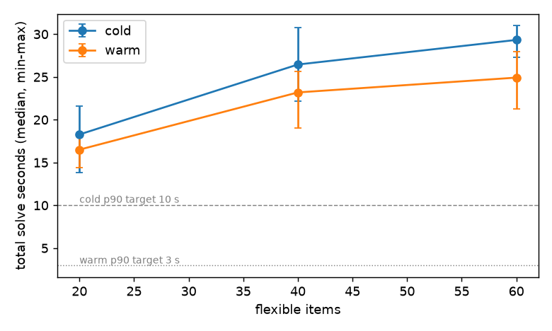
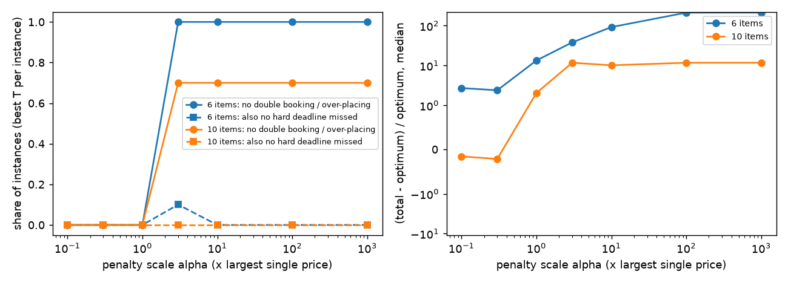
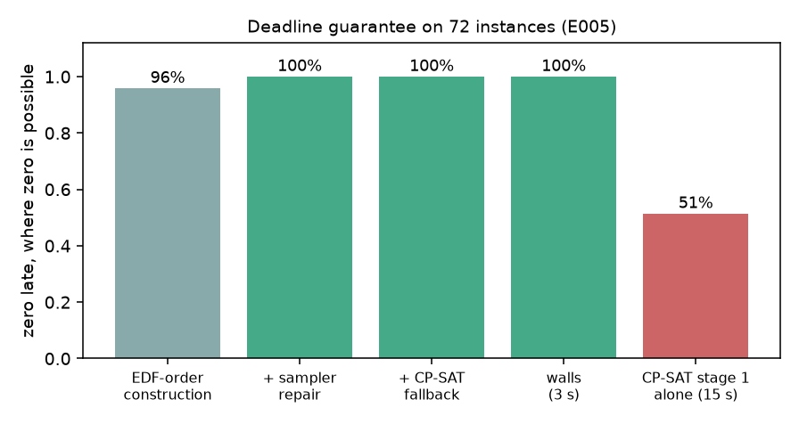
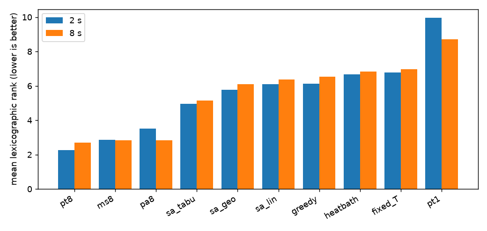
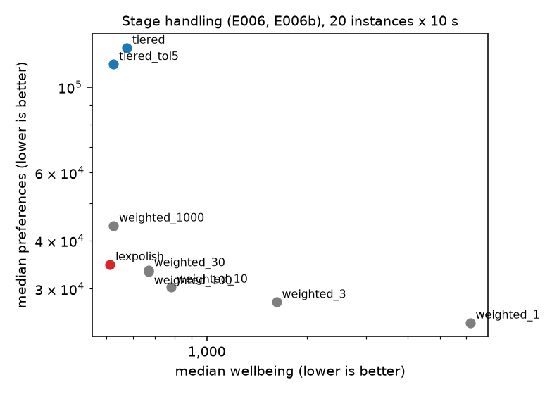
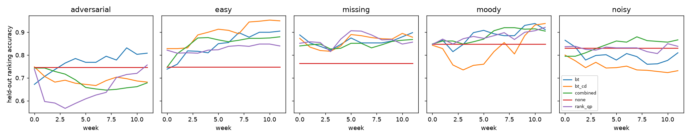
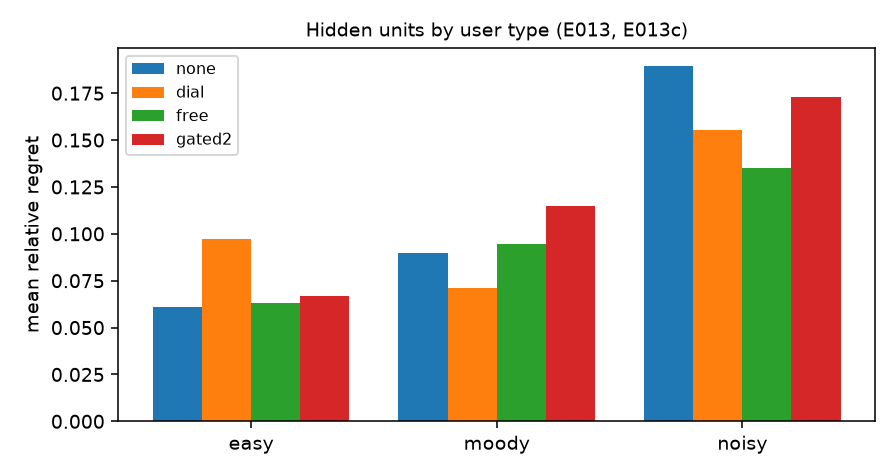
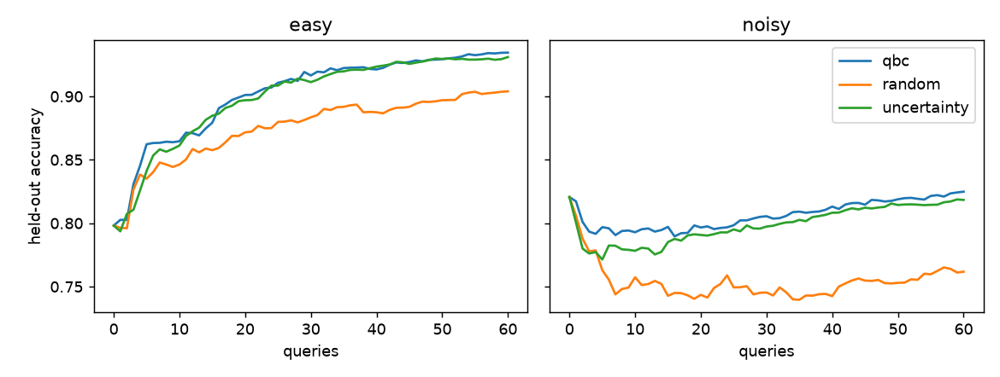
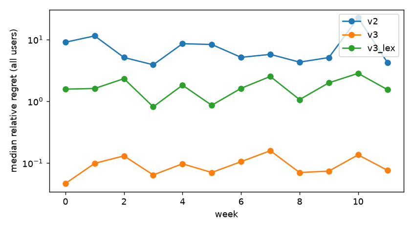

# Friday v3 engine: research report

A research program on rebuilding Friday's scheduling engine around an energy-based (Boltzmann) model with a logical supervisor,
tested against a faithful build of the v2 CP-SAT engine on one shared evaluator. Everything here traces to an experiment folder
(`experiments/E###-*/`, index in section 13); figures are in `report/figures/`; the code is in `src/fr/`.
Sections 14-15 report program 2 (`RESEARCH_PROMPT_2.md`): task lengths learned from estimates and recorded times, three
schedules to pick from, learning from the pick, and constraints parsed from plain language, with the app contract
(`PROTOCOL.md`).

## 1. Summary and recommendation

**Recommendation.** Rebuild Friday's engine as an **energy sampler over the slot grid with walls**, not as a Boltzmann machine
with penalties and not as v2's staged CP-SAT. The state is the owner of each slot; the energy is exactly v2's rule set, computed
incrementally by a compiled kernel that equals the shared evaluator to the integer; hard rules are **walls** (moves that would
break one are never taken); the start plan comes from an earliest-deadline construction that honours every hard rule, a short
sampler repair, and a CP-SAT deadline fallback for the rare remainder. Plans are found by simulated annealing with chunk-level
moves, one chain per idle core, with a fixed step budget. Weights are learned from rankings and drags by a Bradley-Terry
likelihood; the four dials become hidden units that only act on explicit signals until they prove themselves; a supervisor
routes feedback, proposes missing rules for the user to accept, never softens a "never" rule silently, and chooses which
comparisons to ask. Section 12 specifies it.

**Against v2, on the same evaluator** (E017: report seeds, 144 simulated user-weeks per system; E004/E005: 40-100 instances):

| claim | evidence | confidence |
| --- | --- | --- |
| v3 never breaks a hard rule and never misses an avoidable deadline; v2 does both | E017: 0/288 vs 5/144 weeks with a miss or an invalid plan; E005: zero late on 72/72 instances where possible (v2's deadline stage alone 51%); E004: 100% vs 30% deadline-safe | high |
| v3 is about 15x faster on weekly plans and 9-27x on warm replans | weekly plan 1.3 s vs 19.8 s median (E017); warm replan 0.9-2.7 s vs 24 s (E009b); meets the reference's cold (<= 10 s) and warm (<= 3 s) p90 targets, which v2 misses by 2-9x (E001) | high (absolute times measured on a loaded laptop, pessimistic for both) |
| v3's plans are better | regret 0.087 vs 6.13, lower in 144/144 user-weeks (E017); with v2's own lexicographic stage policy still better in 78% of weeks; ties or beats CP-SAT-30 s on every comparable stage at 2-10 s (E004, E007) | high for the engine; the size of the gap depends on the stage policy (below) |
| v3 learns preferences better | learned-weight cosine 0.955 vs 0.866 (E017); held-out ranking accuracy 0.85-0.87 vs 0.82 for v2-style learning, but replicates vary by up to 0.1 (E011-E011c) | medium |
| v3 finds preferences the rule library lacks; v2 cannot | right rule for 6/6 evaluation users by week 4 (E014) and 3/3 semester users (E017); no wrong rule accepted when proposals need the user's yes | medium (one kind of missing rule tested) |
| hidden "mood" units help | 30-40% lower regret for moody users when always on, but 30-60% higher for users without moods; a safe gate keeps only a quarter of the gain (E013-E013c) | medium; use explicit signals (paces) |

**Where v2 is still better.** Given its full 30 s and a good hint, CP-SAT finds lower wellbeing on more warm replans (about 60%
of instances in E009/E009b) and v2's warm replans moved slightly less work before v3's stage scheme was fixed. v2's plans are
optimal for its deadline stage when CP-SAT proves optimality (overload): v3 keeps CP-SAT for exactly that case. And on tight
overload weeks packed with 2-hour minimum chunks, CP-SAT at 30 s on 8 fast cores still finds less lateness (best on 6/6 vs 3/6
for v3's 5 s fallback on efficiency cores, E018d); v3 should give its fallback more time in an overload week.

**The biggest open decision is not the engine but the stage policy.** Strict "wellbeing first, then preferences" costs simulated
users far more than the engine choice does (v3 lexicographic 1.6 vs weighted 0.09 regret); real users may want it anyway. v3
supports both; the recommended default is "lexicographic in effect, weighted in search" (weighted 1000:1 search, then a
preference polish that cannot raise wellbeing).

**What failed** (section 10): the strict QUBO/Boltzmann machine (never deadline-safe at any penalty scale; it cheats or freezes),
penalties instead of walls, an RBM learned from lived weeks without rules, learning from likelihood alone, always-on hidden units,
and asking noisy users many questions.

**Answers to the research questions** (details in the sections named):

| RQ | answer | where |
| --- | --- | --- |
| RQ1 representation | Slot assignment (Potts) with chunk-level moves and walls. The strict QUBO cannot express most rules and fails on the rest; penalties on the full model cheat or cost quality; CP-SAT hybrids (skeleton, LNS) cost more time than they save | 4 |
| RQ2 hard constraints | Walls + EDF-order construction + sampler repair + CP-SAT fallback: zero late on 72/72 instances where possible and every evaluation week; EDF alone is a one-directional test; overload goes through the same three steps, with CP-SAT exact on proven cases | 4 |
| RQ3 stages | Weighted 1:1-10:1 disagrees with the lexicographic answer on 85-100% of instances; 1000:1 on 20% (by <= 3%); strict tiers lose 3x on preferences; recommended: weighted 1000:1 search + capped preference polish | 5 |
| RQ4 samplers and speed | Geometric Metropolis SA with 11 chunk moves (split essential), multi-start on idle cores (as good as PT), tabu finish; 550k moves/s; 2 s matches CP-SAT-30 s; warm replans < 1 s | 5 |
| RQ5 learning | Bradley-Terry likelihood over rankings and drags (drags x3) beats the ranking QP, CD, PCD and v2's moves-only max-margin on average and under deliberate inconsistency; likelihood from lived weeks alone barely learns | 6 |
| RQ6 hidden units | Dial-seeded, multiplicative units; they help moody users (-30-40% regret) and hurt the rest (+30-60%) when always on; use on explicit signals (paces) and behind a temperature-calibrated gate | 7 |
| RQ7 mood vs taste | Decide per user, not per week (single weeks: 23-42% false attribution); the decisive evidence is predictive likelihood of new rankings against a baseline at the user's own answer temperature; without that calibration units win by softening predictions | 7 |
| RQ8 supervisor | Missing rules: the right rule is the top candidate for every tested user by week 12 (6/6 evaluation users already at week 4); propose, add on yes (no wrong rule accepted). Walls: never soften silently; ask once. Queries: QBC/uncertainty halve questions for consistent users; stop asking noisy users | 8 |
| RQ9 guarantees | Determinism with a fixed step budget (all warm reruns identical; independent of thread count); exact per-rule explanations and "why not elsewhere" (tested to equal the evaluator); churn about equal to CP-SAT-30 s with the recommended stage scheme | 5 |
| RQ10 diversity and calibration | T > 0 samples are different plans (66-71% of work slots differ); item-day probabilities calibrated (ECE 0.003-0.009) when T matches the user's noise; but under walls the chain covers only the region reachable from its start (~20% of all valid plans on tiny instances), so it is not a full posterior | 5 |

**Program 2** (section 14; spec in 15): the engine behind the Friday app's Planner page. As shipped, it learns task lengths
from the user's estimates and recorded times, plans hard deadlines at the 95th percentile, asks at most two "how long did
it take?" questions a week, offers three schedules ranked so that the recommended one is the likeliest pick, learns from
the pick, and takes constraints in plain language through Claude Sonnet 5.5 (99% of held-out texts read right). In a
simulated six-week term it misses 8.8% of hard deadlines vs 67.5% for v3 as built, and schedules almost no work
against the person's real habits (0.08 vs 7.8 h a week).

## 2. The problem and how engines were evaluated

The problem is the one in `ENGINE_REFERENCE.md`: place flexible items (fixed amounts, elastic ranges, weekly targets,
open-ended work) into a 14-day grid of 15-minute slots (30-minute slots from day 7), around fixed events and a protected
sleep core, under hard rules (one thing per slot, locks, windows, daily cap, minimum/maximum chunk lengths, one-sitting
items, dependencies, hard deadlines) and 18 reference soft rules in three lexicographic stages: deadlines, wellbeing,
preferences. Every engine in this study solves exactly that problem; nothing was simplified except daylight-saving
changes (a planning day is always 24 h; reference scenario 10 is therefore untested).

**One shared evaluator.** `src/fr/core/evaluate.py` scores any plan by stage and by rule in integer scaled points (100 = one
point) and `check()` lists every hard-rule violation; a plan with any violation is invalid whatever its energy. A second,
independent evaluator (`core/direct.py`, from slot arrays) agrees with it to the integer, both agree with brute force on
tiny instances, and the CP-SAT model's stage values equal the evaluator's on every plan tested. The numba energy kernel
used by the samplers is checked against the evaluator after thousands of random moves of every type
(`tests/test_kernel.py`), as are its hard-violation counts against `check()`.

**Instances.** The reference benchmark (20/40/60 flexible items, 14 days, ~15 h of fixed time a week, 3 pins, 5
dependencies); a Cornell-style semester template (46 items: classes, problem sets, readings, two prelims with prep, a
20-hour project, meals, chores, habits, a weekly goal, social evenings); stress instances (100, 150 items); and adversarial
families (tight deadlines, 1.6-2.2x overload, fragmented free time, long dependency chains, many one-sitting items, many
pins). Tuning used instance seeds 0-99; the end-to-end comparison (E017) used seeds >= 10000 and fresh user seeds, never
tuned on.

**Metrics.** Lexicographic value (late, wellbeing, preferences); per-stage gap to the best value any engine ever found on
that instance (`experiments/refs/best_known.json`), where a later stage is only compared when the earlier ones tie the
best; deadline-safe = valid and zero late work whenever zero is known to be possible (proven by CP-SAT or certified by any
valid zero-late plan); churn = hours of surviving items' work moved by a replan; determinism = identical plan on rerun.
Learning: regret (true energy of Friday's plan minus that of the plan optimised for the user's true weights and mood),
held-out ranking accuracy, weight recovery (cosine), stability, state-inference accuracy, false attribution.
Statistics: medians with IQR and 95% bootstrap confidence intervals; at least 10 seeds per cell for engine comparisons.

**Hardware and a caveat on timings.** Apple M3 Max (12 performance + 4 efficiency cores, 64 GB). From session 2 on, the
laptop was shared with a live service (load average 10-190 on 16 cores); all experiment jobs ran at `nice 19` with BLAS
threads limited to 1. Every timing comparison in this report ran engines interleaved on the same instances under the same
load, so ratios are fair, but absolute seconds are pessimistic for both v2 and v3. CP-SAT was run with 8 workers (its design).
Most of E018 and all of E018b-d ran at background QoS (efficiency cores) at the co-tenant's request; their times are slow for every engine.

## 3. Baseline results (v2: staged CP-SAT on the slot grid)

The baseline is a faithful minimal build of reference section 6A: x / start / cum / any variables, constraints C1-C8, the three
stages each frozen at the evaluator's exact value before the next, a locks-only hint, and the reference's repair of
contradictory locks extended to an unsat-core relaxation (locks can contradict dependencies and chunk limits, which the
reference did not cover). It passes reference scenarios 1-9 and 11-24 and matches brute force on 20 tiny instances.

**E001 (idle laptop, 8 workers, 30 s per solve, reference benchmark n = 20/40/60, seeds 0-9, cold and warm):**

| target (reference 12.4) | required | measured |
| --- | --- | --- |
| cold solve p90 | <= 10 s | 20.5 / 30.2 / 30.7 s (at the cap) |
| warm replan p90 | <= 3 s | 17.7 / 24.7 / 26.2 s |
| deadlines stage | <= 3 s | 4.1 / 7.8 / 10.2 s median |
| executor at 100 items | <= 50 ms | 0.1 ms |
| allocator | <= 1 s | 0.13 s |

The preferences stage was never proven optimal (bound gap 63-94% at its time limit); wellbeing was optimal on 100% / 30% /
10% of runs; repeated solves of one instance with 8 workers differed by up to 2x in the preferences value, so the reference's
"same input, same plan" holds only with one worker; one n=40 run froze a stage-1 plan with 606 hours of lateness.



**E002: tuning it at 10 s.** Six fair variants (fewer fine days, a shorter horizon, one worker, a zero-late constructive plan
as the hint, different stage shares): every variant either timed out (the stage limits double once, so "10 s" took 20-25 s) or
returned hundreds of late hours. Even with a zero-late hint, 7/10 runs timed out: the hint is feasible (fixing variables to it
solves in 0.12 s and the model's stage values equal the evaluator's), but the preferences stage cannot finish presolve inside
its 3 s share. **So the fair baseline is v2 at its own 30 s budget; at equal time (10 s) it is not competitive.**

**Under load.** From session 2 the laptop was shared with a live service. CP-SAT with 8 workers suffered most: "30 s" solves
took 61 s median and were deadline-safe on only 30% of 40 instances (E004), against 70-100% zero-late on the idle laptop (cold: 90% / 70% / 100% at n = 20 / 40 / 60)
(E001). A design that needs eight idle cores for half a minute is fragile on a user's laptop; the sampler uses one core per
chain and scales down gracefully.

## 4. Representations and hard constraints (RQ1, RQ2)

**Four representations were built and measured on the same evaluator:**

| representation | what the state is | how hard rules are held | evidence |
| --- | --- | --- | --- |
| strict QUBO / Boltzmann machine | one binary unit per (item, slot) + slack bits | penalties: A for one-per-slot, B for amounts, deadline via price | E003 |
| slot assignment (Potts) + chunk moves, penalties | the owner of every slot | penalty lambda per violation; only violation-free states are returned | E004, E004b |
| slot assignment + chunk moves, **walls** | the owner of every slot | moves that would break a hard rule are rejected; items on time at the start are protected | E004, E005 |
| hybrids | as above | CP-SAT deadline skeleton then walls; walls then CP-SAT large-neighbourhood polish | E004 |

**The strict QUBO fails, and the failure is structural (E003).** On the slice of the problem a pairwise energy can express
(fixed-amount items with one-unit chunks and price rules only), single-flip annealing with the temperature tuned per instance
never met hard deadlines (0-5% of instances at any penalty scale, against 95% for the optimum). Below about 3x the largest
price the sampler cheats (it over-places items); above it the landscape freezes: the slack bits that turn "placed <= need"
into an equality absorb unplaced work, and leaving that state needs two coordinated flips across a barrier of about the
penalty itself. Plans were 25-200x the optimum. Everything else in the rule set (hinge measures, chunk rules, one-sitting
items, dependencies, the daily cap) needs helper registers per measure (hundreds per instance) with the same problem.
A Hopfield-style descent (T = 0) is no better. Figure: `report/figures/qubo_feasibility_vs_penalty.png`.



**Walls win on the guarantee; quality is close (E004, E005).** With the same moves and the same energy:

| 40 instances, 10 s | valid | deadline-safe | wellbeing gap (median) | preferences gap (median) |
| --- | --- | --- | --- | --- |
| walls | 100% | 100% | 0.000 | 0.000 |
| penalties (1e6 per violation) | 100% | 95% | 0.000 | 0.000 |
| CP-SAT skeleton + walls | 100% | 95% | 0.075 | 0.080 |
| walls + CP-SAT LNS | 100% | 100% | 0.050 | 0.044 |
| staged CP-SAT, 30 s budget (ran 61 s median) | 97% | 30% | 0.000 (8 comparable) | 0.42 (6) |

Penalties failed exactly where the start plan was itself late: walls let an unprotected late item only improve, while the
penalty chain spent its time in infeasible states and its best feasible state stayed late.

**Penalty scale on the full model (E004b, 20 instances, 5 s).** From the constructed start, walls were deadline-safe on 100%;
penalties of 0.1-1x the median move delta were cheated (wellbeing 2-7x worse, 95% safe); 10-100x behaved like walls on wellbeing
but left preferences 15-30% worse; deadlines as an ordinary weight (1x wellbeing) left avoidable lateness on 25% of instances.
From an empty plan every penalty variant missed 4.5-7 hard items (median) against 1 for walls: penalties neither keep nor find
feasibility reliably, which is the QUBO finding again on the full model. Figure: `report/figures/representations.png`.



**The deadline guarantee (E005, 100 instances incl. adversarial families and stress).** Zero late work was known possible on
72 of them. EDF-order construction honouring every hard rule reached zero on 69/72 in under 32 ms; a short sampler repair on
the deadline stage alone fixed the other 3 (100%); the full wall sampler then never let lateness rise. CP-SAT's deadline stage
alone (15 s, 8 workers) found zero on only 51% (0/12 long dependency chains, 2/11 many-pins). On the 5 instances where
lateness is provably unavoidable, construction + repair was optimal on 3/5 and 1.5-3.7x the optimum on 2; CP-SAT hinted with
the repaired plan reached the proven optimum on all 5. On 23 overloaded instances with no proof either way, the sampler
path was at or below CP-SAT's lateness on 20 (typically 2-3x lower).

EDF ignores the daily cap, chunk minimums, one-sitting items and dependencies, so it said "feasible" on all 5 proven-overload
instances: it is a necessary-condition filter and a one-directional certificate, not the guarantee.

**So the guarantee is stated as:** an item that is complete and on time in the start plan can never become late (walls make
this monotone); the start plan is zero-late whenever construction + sampler repair + CP-SAT fallback find one, which was every
instance in this study where one exists. Overload (some lateness unavoidable) is handled by the same three steps, each keeping
the better plan; the remaining lateness is reported per item.

## 5. Samplers and speed (RQ4, RQ9, RQ10)

**The kernel.** A numba energy kernel with incremental deltas runs ~550k move proposals per second on one core (M3 Max,
under load), with every hard rule checked per touched item in ~0.6 µs. Two implementation facts mattered more than any
algorithm: numba helper calls with a 50-array model tuple cost ~100 ns each in reference counting until compiled without the
runtime (`_nrt=False`; 10-15x faster moves), and moves must keep *units*, not slot counts, across the 15/30-minute boundary
(the first version silently trapped all work in week one). Cold JIT compilation is 66 s; the on-disk cache brings it to ~1 s.

**Samplers (E007, 30 instances, 2 s and 8 s, mean lexicographic rank among 10, lower is better):**

| sampler | 2 s | 8 s |
| --- | --- | --- |
| 8 independent chains on 8 cores (multi-start) | **2.3** | 2.8 |
| parallel tempering, 8 replicas on 8 cores | 2.9 | **2.7** |
| population annealing, 32 members on 8 cores | 3.5 | 2.8 |
| geometric SA + tabu finish, 1 core | 6.8 | 5.1 |
| geometric SA, 1 core | 6.1 | 6.1 |
| zero-temperature descent | 5.0 | 6.5 |
| fixed moderate temperature, no annealing | 5.8 | 7.0 |
| heat-bath acceptance | 6.7 | 6.8 |
| parallel tempering on 1 core | 10.0 | 8.7 |

Multi-core methods beat a single chain on 25-29 of 30 instances; replica exchange adds nothing over independent restarts
at these budgets; parallel tempering on one core is the worst (its replicas share the core). Heat-bath and Metropolis are
equivalent. A fixed temperature is no better than descent and worse than annealing given time (prompt section 8).



**Moves (E008).** Split (cut a legal-size piece and move it) is essential: without it wellbeing is 3x worse on every instance,
because walls forbid breaking long runs one slot at a time. Insert, drop and shrink are essential for elastic, target and open
items (they start empty). Far shift and swap matter; transfer, merge, ejection, grow and small shifts are near neutral.

**Stage handling (E006, E006b).** One weighted energy with a 1000:1 ratio between stages matched strictly tiered annealing on
wellbeing for 80% of instances and gave 3x better preferences; lower ratios trade wellbeing away (ratio 1: 4x worse
wellbeing). The recommended scheme searches the 1000:1 energy and then polishes preferences with wellbeing capped (E006b).



**Against CP-SAT on equal time.** At 2 s every sampler above already matches or beats the staged CP-SAT given 30 s on every
comparable stage (E004), and is valid and deadline-safe on every instance where CP-SAT often is not.

**Warm replans (E009).** From the previous plan at a low start temperature: 0.38 s median (p90 0.43 s) for a usable replan, 2.3 s
for one that ties CP-SAT-30 s on wellbeing; CP-SAT warm needs 24 s (and at a 10 s budget reaches zero late on only 33%). CP-SAT
at 30 s does produce better preferences and less churn (37.6 vs 44 h of work moved, median); with the tiered stage scheme the
sampler's first phase ignores `minimize_changes`. E009b re-measures churn with the weighted-then-polish scheme.

**Determinism (RQ9).** With a fixed step budget reruns produce the identical plan (all 90 warm reruns, 89 of 90 cold ones), independent of
thread count (each chain seeds its own generator); the one cold rerun that differed had its step count sized from the
clock. CP-SAT with 8 workers gave the same plan on 53% of reruns. **Exact explanations**: per-rule energies equal the
evaluator's to the integer, and "why not elsewhere" equals the evaluator's difference on every tested move (`tests/`).

**Diversity and calibration (RQ10, E010).** T > 0 samples are different plans (66-71% of work slots differ between samples;
~5 day patterns per item in 16 samples). Item-on-day probabilities from 16 samples were calibrated against simulated users'
lived weeks (ECE 0.003 for consistent users, 0.009 for noisy ones) when the temperature matched the user's own noise, and
over-confident when colder. But under walls the chain does not sample the Boltzmann distribution over *all* valid plans: on
tiny instances where every valid plan was enumerated, it reached only ~20% of them, and longer walks reach no more (the
missing plans need coordinated changes to several items in a full grid). Probabilities are therefore over plans reachable
from the current plan, which is what a user deciding "where will PS5 go" needs, but not a full posterior.

## 6. Learning (RQ5)

**Setup (E011, E011b, E011c).** Simulated users (section 5 of the prompt; `fr/sim/user.py`) have true weight multipliers
(log-normal, sigma 0.6, around the hand-set weights), a mood chain that rescales some weights, per-area duration multipliers,
skips, noisy reviews and check-ins; five types: easy (consistent), noisy (Bradley-Terry temperature 2x the typical energy
gap), moody, missing-feature (a true preference no rule expresses) and adversarial (30% of rankings flipped on purpose). Each
week is a fresh two-week Cornell-style instance; Friday plans with its current weights; the user lives the plan (a short
Metropolis chain under their true energy, started at Friday's plan), may drag (half the weeks), and ranks 6 pairs drawn from
Friday's own T > 0 samples. Features are each rule's cost at its reference weight, so theta = 1 means "the hand-set weights".
Each learner has its own trajectory; 3 users per type, 12 weeks; three replicates (independent for every learner except
"none", whose week stream is the same in replicates 2 and 3).

**Held-out ranking accuracy (200 fixed noise-free pairs on an unseen instance), last 4 weeks, mean over types:**

| learner | replicate 1 (E011) | replicate 2 (E011b) | replicate 3 (E011c) |
| --- | --- | --- | --- |
| none (hand-set weights) | 0.772 | 0.787 | 0.787 |
| v2: max-margin from drags only | 0.823 | - | - |
| ranking QP (every ranking a constraint, slack, prior, step cap) | 0.793 | 0.831 | - |
| contrastive divergence (lived weeks only) | 0.767 | - | - |
| persistent CD | 0.765 | - | - |
| combined (CD step + QP) | 0.827 | 0.834 | 0.844 |
| Bradley-Terry likelihood (drags x3, prior) | - | **0.853** | **0.873** |
| BT + CD | - | 0.828 | - |
| BT with fitted answer temperature | - | - | 0.858 |



**Findings.**
- **Rankings teach fastest; how they are used decides robustness.** The QP (constraints with slack) learned fastest on easy
  users (0.92 in replicate 1, settled in 5 weeks) but fell *below* no learning on noisy, missing-feature and adversarial users in
  replicate 1, and its numbers moved by up to 0.08 between replicates. A likelihood over the same rankings (Bradley-Terry)
  is the best on average in both replicates where it ran and the most robust to deliberate inconsistency.
- **Lived weeks alone teach little** (CD, PCD ~ no learning on accuracy). One lived week is one sample, the user's departure
  from the plan is local, and the scale of the weights is not identifiable from a likelihood (it is the temperature), so CD
  keeps sum(theta) fixed. "Learning from likelihood alone, without the supervisor" is safe but slow.
- **Drags are the cleanest evidence.** v2's moves-only learner was the most robust to adversarial users (0.83) because drags
  come from behaviour, not from answers that can be flipped; weighting drags 3x inside the likelihood keeps that benefit.
- **The answer temperature is the noise detector** (E011c): fitted per user, it sits at 0.05-0.08 for consistent users and at
  0.18-0.5 for noisy, moody, missing-feature and adversarial users. Using it to rescale the fit helped adversarial users and
  hurt moody ones, so it is used to set policies (how many questions to ask, whether contradictions are noise), not the fit.
- **Weight recovery** (cosine with the true multipliers) reaches 0.92-0.95 for easy and moody users and 0.58-0.90 for the rest;
  stability (mean |change| per week in the last 4 weeks) 0.06-0.2 for BT, 0.01-0.08 for the QP (it moves less, and
  learns less when it should not move).
- Regret differences between learners are mostly inside their confidence intervals: one plan per week per learner makes
  regret a noisy metric; accuracy and cosine carry the conclusions.

**Recommendation.** Bradley-Terry likelihood over all rankings and drags (drags x3), Gaussian prior at the hand-set weights,
refitted after each week; lived weeks only as a small CD regulariser for users whose fitted answer temperature is low.
Learning RBMs from lived weeks without rules is a dead end (E012, section 10).

## 7. Hidden units, and mood vs taste (RQ6, RQ7)

**Model.** theta_eff = theta * exp(U h): hidden units rescale rule weights. The four v2 dials are the seeded units: capacity
lowers `daily_load` and `deep_run` weights, rest raises `late_night` and the reserves, spread raises `even_load`, growth raises
`open_value`, `target_shortfall` and `unscheduled`. The additive form E = sum (w + U h) phi was tried first; a planted-state
unit test showed theta's scale and the state trading off against each other (normal weeks read as "motivated"), so the
multiplicative form is the one recommended. A week's units are inferred (MAP) from that week's rankings, its skipped blocks
and a one-tap check-in; taste theta, free loadings and the evidence links are fitted jointly over all weeks. A picked pace
clamps the dial units.

**E013** (3 user types x 3 users x 16 weeks, each mode its own trajectory; easy and noisy users have a mood chain whose moods
change nothing, plus check-ins that report those moods, so any state read for them is a false attribution):

| | none | dial (4 seeded) | dial + 2 free | 6 free, unseeded | oracle mood |
| --- | --- | --- | --- | --- | --- |
| moody users, regret (median, 95% CI) | 0.078 (0.056-0.107) | **0.051** (0.021-0.080) | 0.054 | 0.061 | 0.064 |
| moody users, regret in pace weeks | 0.097 | 0.046 | **0.039** | 0.055 | 0.073 |
| easy users, regret | **0.049** | 0.085 | 0.085 | 0.051 | 0.078 |
| weeks read as non-normal (easy / noisy users: all false) | - | 23% / 42% | 23% / 31% | n/a | - |

- **Seeding matters.** Free units never yield a nameable state and help less (0.061); seeded units give a state the user can
  see ("Friday thinks you're tired this week") and the best regret for moody users.
- **Units have a cost when there is no state.** For easy users the seeded units chase misleading check-ins (23% of weeks read
  as non-normal) and regret rises from 0.049 to 0.085. So units must be switched on per user by evidence.
- **Pace clamping is the biggest single gain**: when the user names their state, regret halves.
- **Mood vs taste (RQ7).** A per-user test, "do the units predict next week's rankings at least 2 nats better (cumulatively)
  than taste alone?", called 8 of 9 users right in E013 (3/3 easy and 3/3 noisy as noise, 2/3 moody as state), but only 5 of 9
  in the replicate E013b (which also weighted drags 3x), for the reason given below. Single-week readings are unreliable
  (false attribution 23% of weeks for easy users, 42% for noisy ones).
  Evidence that separates them: predictive likelihood of new rankings (the decisive one), consistency of contradictions with
  check-ins and skip counts, and clustering of contradictions in time; noise is uncorrelated with all of them.
- Moody users' moods read right in 67% of weeks (normal 22/27, motivated 6/10, tired 4/11): tired weeks are mostly read as
  normal, which errs on the safe side (planning a normal week for a tired user) and is where the check-in and pace help.

**Gating, rounds 2 and 3 (E013b, E013c).** In a second replicate the simple gate ("units predict 2 nats better than
taste") opened for one easy and two noisy users: the units can win by shrinking the weights, which softens predictions and
fits noisy answers, without any state. Comparing instead with taste-only at its best answer temperature closed that loophole:
outside pace weeks the gated units cost mood-free users nothing (easy 0.069 vs 0.066, noisy 0.167 vs 0.167), but they recovered
only a quarter of always-on units' gain for moody users (0.119 vs 0.079 always-on vs 0.133 none): with 6 rankings a week the units
need many weeks to prove themselves. Always-on units replicated their E013 effect (moody 0.106 -> 0.065, easy 0.050 -> 0.095).



**Recommendation.** Dial-seeded units, multiplicative. Use them without proof only on an explicit signal (a picked pace clamps
them); check-ins and skips feed the units' inference, which stays behind the calibrated gate (2 nats over taste at its best
temperature). This trades some regret for moody users for no harm to everyone else, which is the right default for a product.
Free units only after the seeded ones are on and pass the same test. Learning hidden units with no dial seeding (section 8 of
the prompt) is a dead end for a product: no nameable state, slower, no gain.

## 8. The supervisor: routing feedback, missing features, softening walls, active queries (RQ8)

**Routing (built in `fr/system.py`, `fr/supervisor/`).**

| feedback | goes to | how |
| --- | --- | --- |
| a plan that breaks a hard rule; a new hard rule from the user | a wall | added to the problem as a forbid/lock; the kernel's moves can never produce it again |
| a ranking "A better than B"; a manual drag (the user's version beats Friday's) | the ranking model | Bradley-Terry likelihood over all rankings, drags x3, prior at the hand-set weights (a likelihood, not hard constraints: E011) |
| rankings that contradict each other over time | hidden units | only if the per-user predictive test says "state" (E013); otherwise they are noise and stay in the likelihood |
| lived weeks | the likelihood term (CD) | a small step that moves the prior's centre; never on its own (E011) |
| skipped blocks, "not done", check-ins | state evidence | the skip link and the check-in likelihood of the hidden units |
| rankings no weights explain | rule proposal | cross-validated gain of each template rule (E014) |
| work logged inside a "never" window | wall review | one question (E015) |

**Missing features (E014).** A grammar of 132 `time_preference` templates (11 day sets x 6 windows x scope any/deep). For each,
the 5-fold cross-validated gain in ranking log-likelihood when its feature is added; a threshold of 0.114 nats per ranking
was tuned on 6+6 tuning users. On 6+6 fresh users: the right rule ("no work Friday/Saturday evenings") was proposed for 6/6
missing-feature users by week 4 (40 rankings) and was the top candidate at every checkpoint after; users without a missing
feature got false proposals in 33% of week-4 checks, 17% at weeks 6-8 and none from week 10. Auto-adding vs flagging could
not be separated on regret (single-plan regret noise of about +-0.15 exceeds the effect of a preference that rarely binds in
two-week instances). Policy: propose (do not auto-add) from week 6, in plain words, and add the rule on a yes; a refused
proposal is removed from the candidate list. In the end-to-end system (E017) proposals are confirmed by the simulated user.

**Softening "never" walls (E015).** Keeping a stale wall and dropping a real one cost about the same (28 vs 30 points per
two-week plan, ~3% of a plan's energy). Over 12 weeks: ask once at the first contradicting event, regret 15 (0.67 questions per
user); soften after 3 events in 3 distinct weeks within 6, regret 50 and no questions; soften after 1 event, regret 94 (every
one-off user loses their wall); never soften, regret 114. A wall never softens silently.



**Active queries (E016).** For consistent users, query-by-committee (6 bootstrap fits) or uncertainty sampling reach 90%
held-out ranking accuracy in 10-12 questions vs 25 for random pairs. For noisy users every strategy first *loses* accuracy
against the hand-set prior (0.82 -> 0.74-0.80 over 20-60 answers); QBC loses least and recovers to the prior by 60. Policy:
QBC, at most ~10 questions in the first weeks, stop when the committee's disagreement on its own top pair drops below 20% or
when the user's answers contradict each other (estimated answer noise high).

## 9. End-to-end semester simulations (P8)

**E017 (report seeds only: instances 10000+, users 20000+; 4 user types x 3 users x 12 weeks).** Each system keeps its own
trajectory: it plans the week, the simulated user lives it, drags, answers six comparisons (chosen by the system), picks a pace
in 30% of non-normal weeks, and the system learns.

| | **v3** (recommended) | v3_lex (v3 with lexicographic stages) | **v2** (staged CP-SAT 30 s + drags-only learning + paces) |
| --- | --- | --- | --- |
| weeks with a hard deadline missed | **0 / 144** | 0 / 144 | 3 / 144 (9 items late) |
| plans breaking a hard rule | **0 / 144** | 0 / 144 | 2 / 144 |
| plan time, median (p90) | 1.3 s (2.9 s) | 0.8 s (1.5 s) | 19.8 s (29.3 s) |
| relative regret, median | **0.087** | 1.62 | 6.13 |
| weeks with lower regret than v2 | 144 / 144 | 112 / 144 | - |
| learned-weight cosine with the truth | 0.955 | 0.939 | 0.866 |
| missing-feature users given the right rule | 3 / 3 | 3 / 3 | cannot |
| users given a wrong rule | 0 (false proposals refused) | 0 | - |

The simulated users' utility is a weighted sum without stage order, so lexicographic planning carries a built-in regret: v3 vs
v3_lex (0.087 vs 1.62) measures the stage policy, v3_lex vs v2 (1.62 vs 6.13, better in 78% of weeks) measures the engine under the
same policy. Both levers favour v3; the stage policy is the larger one and is a product decision (section 1).

v2's misses came from CP-SAT's deadline stage stopping at FEASIBLE within 30 s on one user's weeks (4-5 hard items late); its
invalid plans came from the lock repair on a partially pinned one-sitting item. v3's construction + walls met every deadline
in all 288 v3 plans. Hidden units never switched on by themselves in 12 weeks (the calibrated gate is slow); moody users were
helped in the weeks they picked a pace, and their regret (0.070) stayed close to consistent users' (0.057). The supervisor asked
on average 0.3-2 rule questions per user over the semester and never added a wrong rule.



**Weakness hunt (E018, E018b-d).** Six adversarial families x 6 seeds, built to break one assumption each. All plans from every
engine were valid. v3 was deadline-safe on every instance; CP-SAT-30 s on 64% (it found no deadline-feasible plan on any
30-item dependency chain or 40-pin instance, and missed 67 hard items on median at 150 items). The hunt broke v3 twice and
both were fixed and re-run:

| failure | evidence | fix |
| --- | --- | --- |
| Without CP-SAT the sampler stays 2-6x later than the optimum on tight one-sitting packing (coordinated moves of whole one-sitting items are rarely accepted under walls) | E018: at best lateness 0/6 vs CP-SAT 6/6 | keep the exact CP-SAT deadline fallback |
| The fallback ran before annealing and on 150 items ate the whole budget, improving nothing | E018: 150 items at best lateness 1/6 (v3) vs 3/6 without CP-SAT | anneal first on large instances: 5/6 (E018b) |
| Annealing first loses on small packed instances | E018b: tight + 2 h chunks 3/6 vs 5/6 | order by size: CP-SAT first up to 60 items (E018c-d) |

**What still stands against v3:** tight overload packing with 2-hour minimum chunks, where CP-SAT at 30 s on 8 performance cores
reaches the best lateness on 6/6 and v3's 5 s fallback on efficiency cores on 3/6 (1-21% more lateness on the others; 5/6 when
the same path ran on performance cores). In an overload week a longer fallback (10-30 s) is acceptable and closes most of it.

## 10. Dead ends (what failed and why)

| tried | result | why it fails | evidence |
| --- | --- | --- | --- |
| Strict QUBO / Boltzmann machine with penalty weights for every hard rule | Never meets hard deadlines (0-5%) at any penalty scale; 25-200x the optimum | Small penalties are cheated (over-placing); large ones freeze the search: slack bits absorb unplaced work and leaving needs two coordinated flips across a barrier of about the penalty. Most rules cannot even be written pairwise | E003 |
| Hopfield-style network (greedy single-flip descent) on the same energy | No better than annealing at T = 0: 0% feasible at alpha 1, misses 4 hard items at alpha 10 | Spurious attractors of the penalty landscape | E003 |
| Huge penalty weights on the full model (Potts state, chunk moves) | 95% deadline-safe instead of 100% | From a late start the chain explores infeasible states and its best feasible state stays late | E004, E004b |
| Pure weighted stages, ratio 1-10 | Wellbeing worse on 85-100% of instances (4x at ratio 1) | The ratio decides the trade; a small one is not "wellbeing first" | E006 |
| Strictly tiered annealing (wellbeing with preferences switched off, then preferences under a cap) | Preferences 3x worse than a weighted search at ratio 1000, wellbeing no better on 80% | Optimising one stage alone leaves the next in a state the cap forbids repairing | E006 |
| A fixed moderate temperature with no annealing | Worse than annealing given time (mean rank 7.0 vs 6.1 at 8 s) and no better than zero-temperature descent | With no cooling the chain neither explores early nor settles late; from a good start, plain descent does as well | E007 |
| Parallel tempering on a single core | Worst sampler at both budgets (beaten by single-chain SA on 25/30) | 8 replicas share one core, each gets 1/8 of the steps; replica exchange adds nothing over restarts here | E007 |
| CP-SAT deadline skeleton for every instance | Hurt quality and missed deadlines twice | A 3 s CP-SAT stage-1 solution is often later than the 1 ms construction | E004 |
| CP-SAT large-neighbourhood polish at a 10 s budget | Worse wellbeing than pure annealing | Each neighbourhood solve pays model build + presolve (1-2 s): too few exact moves per second | E004 |
| An RBM trained on lived weeks, no rules | Ranks plans at 0.62-0.64 vs 0.80-0.87 for the rules; samples are not schedules | An occupancy picture cannot see items, amounts or deadlines; lived weeks are Friday's plan plus a small drift | E012 |
| Learning weights from likelihood alone (CD, PCD) | Barely moves held-out accuracy in 12 weeks | One lived week is one sample, and the departure from the plan is local; the scale of the weights is not identifiable | E011 |
| Ranking QP with hard constraints for every ranking | Best on consistent users, worse than no learning on noisy, missing-feature and adversarial users | Slack does not stop it bending the weights to fit noise, moods and preferences no rule expresses | E011 |
| Hidden units learned without dial seeding | No nameable state, smaller regret gain than seeded units | Nothing anchors the units; free loadings fit noise | E013 |
| Hidden units always on | Regret up from 0.049 to 0.085 for users with no moods | Units chase misleading check-ins (false attribution 23-42% of weeks) | E013 |
| Asking random comparisons of noisy users | Accuracy falls below the hand-set prior and stays there for 60 answers | Noisy answers move the weights more than they inform them | E016 |
| Softening a "never" wall after one contradicting event | Every one-off user loses their wall | One event cannot tell a change of mind from an exception | E015 |
| A time budget (steps sized from measured speed) as the production limit | Plans depend on machine load, breaking determinism | Determinism needs a step budget per instance size | E009 |

## 11. Risks, limits and open questions

**What simulated users cannot tell us.**
- Real preferences may not be a weighted sum of the 18 reference features plus a few templates. The simulated users are, by
  construction, inside or one template outside the model; real users can be further out, and then every learner plateaus
  (missing-feature users in E011 show what that looks like). Discovery covers only `time_preference` templates.
- Real moods are not three states with fixed multipliers, real noise is not Bradley-Terry, and real users answer comparisons
  lazily, strategically or not at all. The learning numbers (E011-E016) rank methods; their absolute values will not transfer.
- Lived weeks were simulated as a short chain under the true energy from Friday's plan; real departures (illness, a missed
  bus) are not energy-driven, which is one reason likelihood learning from lived weeks should stay a weak regulariser.

**Statistical limits.** Learning experiments used 3 users per type (machine sharing forced the cut from 5); replicates
disagreed by up to 0.1 in accuracy for single cells (E011 vs E011b), so only differences that held across replicates are
claimed. Regret per week is a single-plan measurement with noise of roughly +-0.15 relative, so regret comparisons between
learners are mostly inconclusive; accuracy and weight recovery carry the learning conclusions. Engine comparisons used 10-40
instances per cell on tuning seeds; the final end-to-end comparison (E017) used report seeds only.

**Timing.** From session 2 the laptop was shared with a live service (load 10-190 on 16 cores) and all jobs ran at nice 19.
Comparisons ran interleaved and are fair, but absolute times are pessimistic, especially for 8-worker CP-SAT. The 548k
proposals per second and the reference targets should be re-measured on an idle machine before quoting them as product numbers.
Cold numba compilation takes ~66 s; a shipped engine must ship its compiled cache (or an ahead-of-time build).

**Engine risks.**
- The deadline guarantee rests on finding a zero-late start. Construction + sampler repair found one on every instance where one
  exists in this study (72/72), and the CP-SAT fallback covers the rest, but this is NP-hard in general (one-sitting items,
  minimum chunks). Keep the exact fallback and report the rare case it is used.
- Walls make lateness monotone only for items protected at the start; items that start late are optimised, not guaranteed.
- The kernel's exactness is enforced by tests against the shared evaluator; any new rule type must come with the same
  differential test or the guarantee "explanations are exact" breaks silently.
- DST is simplified away (a planning day is always 24 h).
- A bug found late (E018d): the deadline fallback passed its 5 s as the total CP-SAT limit, so the deadline stage got 2 s. E005's
  fallback results (exact on 5/5 proven overloads) were obtained with 2 s; the fix only gives the fallback more time.
- The size threshold (60 items) that orders CP-SAT-first vs annealing-first is a heuristic from 36 adversarial instances, not tuned.

**Open questions.**
- Per-user answer temperature: it detects noise (E011c) but using it inside the fit hurt moody users; a joint model of noise and
  mood is the natural next step.
- Faster state detection: the calibrated gate (E013c) is safe but slow; more evidence per week (skips and reviews with learned
  links, more check-ins) should speed it up, untested.
- Calibration of T > 0 probabilities against what users do (E010) depends on knowing the user's noise; see section 5.
- Interval (no-grid) CP-SAT (reference 6A.9) was not built; it might change the baseline's speed, not its staged design.

## 12. Recommended v3 engine specification

Everything below is implemented in `src/fr/` and was measured in the experiments cited; numbers are defaults to start from.

### 12.1 Problem and state

- **Problem**: unchanged from `ENGINE_REFERENCE.md` (items, facets, fixed occurrences, nights, grid of 15/30-minute slots,
  the 18 reference soft rules plus user rules, dials). The grid, builder, pruning and lock repair are reused as they are.
- **State**: one owner per slot, `owner[s] in {-1} ∪ items` (int16). This is the Potts / slot-assignment representation;
  "one thing per slot" holds by construction. Chunks are maximal runs of one item's slots.
- **Compiled model** (`engines/compile.py`): the problem flattened into arrays: per-stage price tables `price[stage, item, slot]`
  and overflow costs; every measure (hinge rule) as a sparse linear expression over x(item, slot) x units, chunk starts,
  overflow and any(group) indicators, each with its convex hinge curve (integer coefficients exactly as the reference
  rounds them); per-rule price tables for explanations; the hard-rule data (allowed slots, locks, windows, chunk limits,
  one-sitting flags, dependency lag tables, daily caps).

### 12.2 Energy

E(x) = sum over stages k of w_k x V_k(x), where V_k is the exact integer stage value of the shared evaluator (prices of occupied
slots + overflow costs + hinge costs of measures). Maintained **incrementally**: a slot changing owner updates the prices,
the measures it appears in (with hinge cost deltas), chunk-start indicators of the two neighbouring slots, any-group counts and
overflow. Exactness is a tested invariant: after any sequence of moves the kernel's stage values equal `evaluate()` and its
hard-violation counts equal `check()` (`tests/test_kernel.py`). Per-rule totals can be recomputed from scratch in ~50 µs
(`rule_totals`) for explanations and learning features.

### 12.3 Walls (hard rules)

A move is rejected if it would produce any hard violation the checker knows: slot outside the item's allowed set, a lock
touched, amount above its cap, chunk shorter than the minimum or longer than the maximum, a second chunk of a one-sitting item
or a partial one, a dependency read before its source reached the required amount (lag-aware), a day above the hard cap.
Only the items a move touches (and their dependents) are re-checked (`item_viol`, ~0.6 µs per item). **Deadline wall**: an item
that is complete and on time in the start plan is *protected*: it may only use slots ending by its due time and may never lose
units. Items late at the start are not protected; their lateness is the deadline stage of the energy, weighted 10^6 times the
other stages, so moves can only shorten it.

### 12.4 Start plan, repair and overload

1. **Construct** (`engines/construct.py`, < 32 ms at 150 items): items in earliest-effective-deadline order (a source inherits the
   earliest deadline of its dependents; dependencies are placed first), each into the earliest free slots that honour windows,
   the daily cap, chunk minimums and maximums (keeping legal remainders), one-sitting runs and dependency readiness; hard items
   use on-time slots first. Elastic, target and open items start empty. With a previous plan (warm start) everything still
   allowed is kept and only missing amounts are placed. If construction leaves violations caused by locks, those locks are
   demoted to preferred pins (as v2's repair) and construction reruns.
2. **Repair** (`engines/repair.py`) if the start is late: the sampler on the deadline stage alone, hard rules as penalties
   (lambda 10^9), 400k proposals, best violation-free state.
3. **Exact fallback**, only while lateness remains, ordered by size (`engines/api.run_v3`, E018-E018d): up to 60 flexible items,
   CP-SAT's deadline stage first (hinted with the repaired plan, 5 s for the stage, longer in an overload week), then the wall
   sampler; above 60 items, the wall sampler first for the budget, then CP-SAT hinted with its plan. Every step keeps the less
   late plan.
Measured: zero late on 72/72 instances where it is possible (construction alone 69/72); on proven overload the fallback reached
the optimum on 5/5; on unproven overload the sampler path beat CP-SAT-15 s on 20/23 (E005); deadline-safe on 36/36 adversarial
instances (E018). Remaining lateness is reported per item.

### 12.5 Move set (11 moves, `engines/kernel.py`)

All moves keep units exact across the 15/30-minute boundary. Probabilities (relative): shift 1-4 slots 3 (reduce to ~1, E008),
swap two equal-unit chunks of different items 1, grow 1, shrink 0.5, transfer k units between chunks of an item 1, **split** a
legal-size piece off a chunk and move it 1 (essential), merge next to a sibling chunk 1, **far shift** anywhere in the window 1.5,
**insert** a new chunk (min-chunk units, or the whole amount for one-sitting items) 1, **drop** a chunk 0.3, **eject** (move a chunk
onto another item's chunk and re-place that one) 0.5. Removing split makes wellbeing 3x worse; removing insert/drop/shrink
breaks elastic, target and open items (E008).

### 12.6 Sampler

- **Metropolis, geometric schedule** T0 = 0.1 x median |delta|, T1 = 0.003 x median |delta|, where the median is taken over 1,500
  random valid moves from the start that leave the walled stage unchanged (E-calibration finding: including deadline-stage
  deltas sets T ~ 10^9).
- **Stage handling ("lexpolish", E006)**: 60% of the steps on E = 10^6 D + 1000 W + P, then 40% on 10^6 D + P with W capped at the
  value reached (moves raising wellbeing are rejected). This is lexicographic for wellbeing at the end and searches like a
  weighted sum; strictly tiered annealing left preferences 3x worse (E006). E006b: same median wellbeing as tiered, preferences
  2.3x better, better than tiered and than the pure weighted search on 95% of instances; wellbeing a few percent worse on 20%.
- **Parallelism**: independent chains from the same start on all idle performance cores, best result wins (multi-start was as
  good as parallel tempering in E007); a short tabu finish (20% of steps, 25 candidates, tenure 8) when the budget exceeds ~5 s.
- **Budgets and determinism**: a *step* budget per instance size, not a time budget (E009): ~0.5-1 M proposals per chain for a
  cold plan of 40-60 items (~1-2 s at 550k/s), 0.3 M for a warm replan at T0 = 0.01 x median. Same input, seed, profile and step
  budget give the identical plan, on any thread count (each chain seeds its own generator).
- JIT: ship the numba cache; cold compile is ~66 s (E007).

### 12.7 Warm replans

Start from the previous plan (construct with `base`), repair if late, protect what is on time, anneal with lexpolish from a
low temperature (T0 = 0.01 x median |delta|) with the reference's `minimize_changes` rule active. E009/E009b: 0.9 s (p90 0.94 s)
for a 1 s replan, 2.7 s for a 3 s one, against 24 s for CP-SAT warm; churn 38.6 h median at 3 s (CP-SAT-30: 37.6 h); zero late
on every instance where any engine reaches zero.

### 12.8 Explanations

Per-rule energy = `rule_totals` (exact, equals the evaluator). "Why not elsewhere": relocate the chunk to the asked slot in a
scratch state; if the move breaks a hard rule the answer is that rule (a wall); otherwise the per-rule energy difference, top
three rules first (`engines/explain.py`, tested to equal the evaluator difference).

### 12.9 T > 0 samples and probabilities

Samples come from chains at a fixed temperature from the plan (E010). See section 5 for diversity and calibration; only quote
probabilities when the temperature is matched to the user's estimated noise.

### 12.10 Learning (sections 6-8)

- **Weights**: theta = multipliers on the hand-set rule weights; features phi_r = rule r's cost at its reference weight.
  Bradley-Terry likelihood over every ranking and drag (drags x3), P(A beats B) = sigmoid(-theta·(phi_A - phi_B)/(|.|_1 s)),
  s = 0.05, Gaussian prior N(1, 1) per weight, theta >= 0.02, refit after each week; optional small CD step from lived weeks
  for users with low answer noise.
- **Answer noise**: fitted per user (temperature grid 0.02-0.5, cross-validated); used for the query budget and the state test.
- **Hidden units**: theta_eff = theta x exp(U h), U = the four dials' rule loadings; a picked pace clamps h; automatic inference
  of h from rankings, skips and check-ins only after the units beat taste-only-at-its-best-temperature by 2 nats of predictive
  log-likelihood (E013c).

### 12.11 Supervisor policies (section 8)

Hard-rule feedback -> walls. Rankings and drags -> the likelihood. Contradictions -> the state test (units on only if it passes).
Lived weeks -> small CD regulariser. Skips, check-ins -> state evidence. Missing features: every 2 weeks from week 6, the
cross-validated gain of each of 132 `time_preference` templates; propose the best above 0.114 nats per ranking in plain words;
add it only on the user's yes. Walls never soften silently: one question at the first contradicting event (or, with questions
off, propose softening as a price after 3 events in 3 distinct weeks within 6). Active queries: query-by-committee (6 bootstrap
fits), at most ~10 questions in the first weeks, stop when committee disagreement < 20% or the answer noise is high.

### 12.12 Expected performance (laptop, single core per chain; measured under load, so conservative)

| quantity | measured | reference target |
| --- | --- | --- |
| hard-rule violations | 0 in every v3 plan of every experiment (thousands of plans) | 0 |
| avoidable lateness | 0 on 72/72 (E005), 36/36 adversarial (E018), 288/288 semester plans (E017) | 0 |
| cold plan, 40-60 items | 1.3 s median, 2.9 s p90 (E017, 2 s step budget) | p90 <= 10 s |
| warm replan | 0.9 s median / 0.94 s p90 at a 1 s budget; 2.7 s at 3 s (E009b) | p90 <= 3 s |
| construction (the deadline-feasible start) | 0.7 ms median, 32 ms max at 150 items (E005) | (deadline stage <= 3 s) |
| move proposals | ~550k per second per core (E007) | - |
| quality vs v2 at 30 s | ties or beats on every comparable stage at 2-10 s (E004, E007); behind on tight 2 h-chunk overload packing (E018d) | - |
| determinism | identical plan for the same input, seed, profile and step budget, any thread count | same input -> same plan |
| JIT | ~66 s cold, ~1 s from the shipped cache | - |

## 13. Appendix

### 13.1 Experiment index

| id | question | folder | finding (one line) |
| --- | --- | --- | --- |
| E001 | How fast and good is faithful v2? | `experiments/E001-v2-baseline` | Misses every speed target (cold p90 20-31 s, warm p90 18-26 s); preferences never proven optimal; not deterministic with 8 workers |
| E002 | Can v2 work at 10 s with fair tuning? | `E002-baseline-tuning` | No: times out or hundreds of late hours in every variant; fair baseline = 30 s |
| E003 | Strict QUBO / Hopfield with penalties | `E003-strict-qubo` | Dead end: 0-5% deadline-safe at any penalty scale; cheats or freezes |
| E004 | Representations on equal budgets | `E004-representations` | Walls: 100% valid and deadline-safe, best quality at 7 s; CP-SAT-30 s 30% deadline-safe under load |
| E004b | Penalty scale on the full model | `E004b-penalty-scale` | Penalties cheat (small) or cost 15-30% preferences (large); deadlines as weights leave avoidable lateness on 25% |
| E005 | Deadline guarantee | `E005-deadline-guarantee` | Construction + sampler repair: zero late on 72/72 where possible (CP-SAT alone 51%); CP-SAT fallback exact on proven overload |
| E006 | Stages: lexicographic vs weighted vs tiered | `E006-stages` | Weighted 1000:1 matches tiered wellbeing on 80% with 3x better preferences |
| E006b | Weighted search + capped polish | `E006b-stage-polish` | lexpolish: preferences 2.3x better than tiered at the same median wellbeing |
| E007 | Samplers on equal wall clock | `E007-samplers` | 8-core multi-start ~ PT ~ population annealing, best; PT on 1 core worst; heat-bath = Metropolis |
| E008 | Which moves matter | `E008-move-ablation` | split essential; insert/drop/shrink essential for elastic/target/open items |
| E009 | Warm replans, churn, determinism | `E009-warm-determinism` | Warm 0.4-2.3 s vs CP-SAT 24 s; identical reruns with a fixed step budget; CP-SAT-30 better on quality and churn |
| E009b | Warm churn with lexpolish | `E009b-warm-churn` | Churn down 9-12% to CP-SAT-30's level; zero late equal to CP-SAT with the repair step |
| E010 | Diversity and calibration | `E010-diversity-calibration` | Samples diverse; calibrated when T matches the user's noise; walls make the chain reach only ~20% of tiny valid sets |
| E011 | Which weight learner | `E011-learning` | QP fastest on consistent users but bends to noise; drags cleanest; CD alone weak |
| E011b | Bradley-Terry likelihood | `E011b-learning-round2` | BT best on average and on adversarial users; replicates vary by up to 0.1 |
| E011c | Fitted answer temperature | `E011c-learning-round3` | Detects noise (0.08 vs 0.18-0.5); used for policies, not the fit |
| E012 | RBM from lived weeks only | `E012-rbm-from-data` | Dead end: 0.62-0.64 ranking accuracy vs 0.80-0.87; samples are not schedules |
| E013 | Hidden units, mood vs taste | `E013-hidden-units` | Seeded units help moody users, cost the rest; state-vs-noise test right for 8/9 users |
| E013b | Gate units per user | `E013b-gated-units` | Naive gate fails (units win by softening predictions) |
| E013c | Gate vs a calibrated baseline | `E013c-gate-vs-temperature` | Safe for mood-free users; keeps a quarter of the gain for moody users |
| E014 | Missing-feature detection | `E014-missing-features` | Right rule for 6/6 by week 4; false proposals 33% -> 0% by week 10; propose, add on yes |
| E015 | Softening walls | `E015-soften-walls` | Ask once at the first contradicting event; never soften silently |
| E016 | Active querying | `E016-active-queries` | QBC/uncertainty halve the questions for consistent users; noisy users: asking hurts |
| E017 | End-to-end semesters, v3 vs v2 | `E017-semesters` | Report seeds: v3 0 misses / 0 invalid in 288 plans, 1.3 s vs 19.8 s, lower regret in 144/144 weeks |
| E018 | Weakness hunt | `E018-weakness-hunt` | v3 deadline-safe 36/36 (CP-SAT 64%); two v3 failures found (packing without CP-SAT; fallback eating the budget) |
| E018b | Fix: anneal before CP-SAT | `E018b-weakness-fix` | 150 items fixed (5/6 at best lateness); small packed instances worse |
| E018c | Fix: order by size | `E018c-size-rule` | keeps both gains; tight 2 h-chunk packing still behind CP-SAT-30 |
| E018d | The fallback's time | `E018d-fallback-time` | 5 s on efficiency cores: 3/6 at best (P-cores: 5/6) |
| E019 | Constraints from text (program 2) | `E019-constraint-parsing` | Sonnet 5.5 + guide v2 + structured output: 99.0% of held-out texts fully right (3 runs); no guide 87.9% |
| E020 | Duration models | `E020-duration-models` | Hierarchical fused + fading memory + recalibration: CRPS 0.187 vs 0.290 as given; user's estimate first until 3 recordings |
| E021 | Durations downstream | `E021-durations-downstream` | Learning cuts hard misses 2-4x; p95 for hard deadlines: 4.3% late for 23 min/day unused |
| E022 | Three schedules | `E022-three-schedules` | Thompson alternatives ranked by posterior pick probability: recommended picked 63% (from 27%), lived regret unchanged |
| E023 | Learning from the pick | `E023-pick-learning` | Picks alone (MNL): -25% regret; adding pairs and drags hurts missing-rule and adversarial users |
| E024 | When to ask | `E024-asking-policy` | Two "how long did it take?" a week: misses 2.9% -> 0.2% at p95; estimates only trade padding |
| E025 | The whole loop | `E025-end-to-end` | As shipped vs v3 as built: hard misses 8.8% vs 67.5%, habit conflicts 0.08 vs 7.8 h/week |

### 13.2 How to reproduce

```
cd BackendGuidelines
uv sync                                  # Python 3.12, numpy, numba, OR-Tools 9.15, scipy, cvxpy, pandas, matplotlib
uv run pytest                            # 195 tests: evaluator, checker, EDF, kernel exactness, walls, determinism, learning, product
cd experiments/E004-representations && uv run python run.py && uv run python analyze.py   # any experiment the same way
uv run python report/make_figures.py     # rebuilds report/figures from the results
```

Every experiment folder has `README.md` (written before running), `config.toml`, `run.py` (`--smoke` for a 1-instance check,
`--shard=i/n` where the user loop is long), `results/*.csv`, `analyze.py`, `notes.md`. `experiments/refs/best_known.json` holds the
best valid value any engine found per instance (all gaps are measured against it). Seeds: instances 0-99 for tuning, 10000+
(and users 20000+) for the end-to-end evaluation. Order matters: OR-Tools must be imported before cvxpy (both bundle HiGHS;
`fr/__init__.py` takes care of it).

### 13.3 Hardware

Apple M3 Max, 16 cores (12 performance, 4 efficiency), 64 GB RAM, macOS 26.6, Python 3.12 via uv, numba 0.68, OR-Tools 9.15.
Session 1 ran on an idle machine (E001); from session 2 the machine was shared with a live service (load average 10-190), all
jobs at `nice 19`, BLAS/OpenMP threads at 1 (see section 2 on what that means for timings).

## 14. Program 2: durations, three schedules, picks and constraints from text

Program 2 (`RESEARCH_PROMPT_2.md`, experiments E019-E025) answers what the Friday app needs on top of the v3 engine, as the
user asked for it: (1) start from the user's own estimates of how long assignments take, record how long they really took,
predict future lengths from that, and occasionally ask for more lengths; (2) offer three schedules to pick from; (3) learn
from the pick so the recommended schedule becomes the one the user would pick; (4) accept many constraints written in plain
language (sleep habits, no work after a time, commitments, limits), parsed by an LLM. Same rules as program 1: one shared
evaluator, tuning seeds vs report seeds, at least two improvement rounds per main question, everything reported.

### 14.1 Constraints from text (RQ16, E019)

**Design.** The LLM never plans. It translates text into twelve typed constraint kinds (`src/fr/product/constraints.py`):
sleep, avoid a window, prefer a window, commitment, daily limit, keep time free, session length, one sitting, pacing,
finish early, buffer around events, order of two tasks; plus "questions" (ask instead of guessing) and "unsupported"
(report what cannot be expressed). Each constraint carries the words it came from and a one-line paraphrase the user
confirms; only confirmed constraints are stored. Compilation into the engine is deterministic: hard constraints become
walls (forbidden slots, chunk limits, earlier deadlines, the daily cap, fixed events, sleep core), soft ones become rule
weights at three strengths. Claude Sonnet 5.5 runs through the `claude` CLI exactly as the Friday app already runs it (no
tools, no MCP servers, no saved session), with the CLI's structured output.

**Evaluation.** 101 hand-labelled texts written before any model call (sleep, windows, commitments, limits, sessions,
pacing, buffers, ordering, multi-constraint paragraphs, ambiguous texts that require a question, unsupported requests,
chatter and permissions); every third held out. A case counts only if the stored constraints equal the labelled reading
(or a listed alternative) with nothing extra, a question is asked exactly when required, and unsupported requests are
reported. Targets are compared by the tasks they select.

| prompt | tuning (68) | held out (33) |
| --- | --- | --- |
| role + schema only | 91.2% | 87.9% |
| + translation guide (round 1) | 97.1% | 97.0% |
| guide with the schema in the prompt instead of structured output | 89.7% | - |
| **guide v2** (round 2: "useless / impossible" = hard; non-constraint requests are reported) | 98.5% | **99.0%** (3 runs; 32/33 right every time) |
| guide v2 + six worked examples | 98.5% | - |

- Every reply was valid and compiled; no invented constraints on the held-out split. Median 3.3 s per text, about
  $0.006 at list price.
- Without the guide, the model asks needless questions and turns unsupported requests into something else (alternating
  subjects became "spread out"). Passing the schema in the prompt made it ask about every missing optional field.
- The one held-out miss reported "sessions of about 2 hours" as inexpressible (true: the schema has no target length)
  instead of reading it as a 1-2 hour range.
- Limits: one context, 101 texts by one author, English, typed. Real users will be more varied; the confirmation step is
  the safety net (figure: `experiments/E019-constraint-parsing/figures/accuracy.png`).

### 14.2 Predicting how long tasks take (RQ11, RQ12, E020, E021)

**Simulated students** (`src/fr/sim/durations.py`): a term of four courses (problem sets, readings, labs, essays, two
prelim preps, a project). True length = kind base x course difficulty x course-kind effect x a drift over the term x item
noise. The student's preliminary estimate sees the expected length and part of the item's own noise, shifted by a
personal bias and estimate noise; six types: calibrated, optimist (estimates ~64% of the truth), noisy, kind-biased
(underestimates problem sets and essays only), drifting (bias grows 6% a week), sparse (estimates 30% of tasks, records
half). Recorded lengths carry a little noise and are sometimes missing.

**Models** (`src/fr/product/durations.py`): estimate as given; one personal bias; per-kind bias; the hierarchical
log-normal of ENGINE_REFERENCE section 11 (two Bayesian ridge regressions over all / kind / course / course x kind: one for
log(actual / estimate), one for log length) with or without fusing the two; fading memory (4-week half-life); nearest
recent tasks; online recalibration from the model's own one-step-ahead errors.

| E020 (60 students, weeks 2-9) | CRPS (log min) | median abs log error | p50 / p80 coverage |
| --- | --- | --- | --- |
| estimate as given | 0.290 | 0.338 | 0.27 / 0.55 |
| one personal bias | 0.218 | 0.248 | 0.47 / 0.79 |
| hierarchical, not fused | 0.223 | 0.250 | 0.47 / 0.77 |
| hierarchical, fused, fading memory | 0.186 | 0.219 | 0.44 / 0.75 |
| **+ recalibration (chosen; fused after 3 recordings)** | 0.187 | 0.217 | 0.47-0.48 / 0.80 |

- The planning fallacy is mostly one number per person: a single bias multiplier removes most of an optimist's error
  (0.333 -> 0.178). Fusing the estimate with the student's own history is what helps noisy estimators (0.318 -> 0.215).
- Calibrated students lose a little with any learning (0.143 -> 0.155): their estimates were already right.
- Round 3 checked two things. Students whose typical lengths sit far from Friday's population defaults (0.5 log sd) do not
  change the ranking. And the user asked for their own estimates to be the starting point: fusing with population defaults
  from the first task predicts better in the first two weeks (CRPS 0.236 vs 0.267), but turns "I think 2 h" into 2 h 40 m
  on day one. The shipped model uses the user's estimate (times the learned ratio) until three lengths are recorded; after
  week 2 the two are identical.

**Downstream (E021).** What matters for the user is missed deadlines, not prediction scores. A term simulator replans
every morning with v3 at a fixed step budget, reserving for each open task a quantile of its predicted remaining length
(p50 for flexible tasks, a higher quantile for hard deadlines); work proceeds on the true lengths. 24 students on report
seeds, 8 weeks, a heavy load (1.5x).

| hard-deadline tasks late / reserved-but-unused h per day | p50 | p80 | p90 | p95 |
| --- | --- | --- | --- | --- |
| estimate as given | 67.9% / 0.64 | 36.5% / 1.08 | 20.5% / 1.31 | 9.8% / 1.49 |
| one personal bias | 41.9% / 0.91 | 10.9% / 1.42 | 5.6% / 1.62 | 3.6% / 1.84 |
| **shipped model** | 46.8% / 0.79 | 15.1% / 1.18 | 8.4% / 1.49 | **4.3% / 1.57** |
| true lengths (reference) | | 0% / 0.13 | | |

- Learning lengths cuts missed hard deadlines by 2-4x at every quantile.
- Round 1 compared models at p80 only, and the single-bias model looked better downstream (10.9% vs 15.1%) despite
  predicting worse: its wider spreads buy more padding. Along the whole frontier (round 2; figure
  `experiments/E021-durations-downstream/figures/frontier.png`) the shipped model misses fewer deadlines for the same
  unused time at every point, so E020's choice stands.
- **The quantile matters more than the model.** p80 -> p95 cuts misses from 15.1% to 4.3% and hours late from 116 to 34
  per student-term, for 23 more minutes a day of reserved time that ends up unused. The product plans hard deadlines at
  p95.
- Readings and other flexible tasks finish late often (59-63%; 35% even with true lengths): the planner trades soft
  lateness against wellbeing, as designed.

**When to ask (RQ13, E024).** The user asked that Friday "occasionally, if needed" ask for more lengths. Two kinds of
question: an estimate for a new task, and the actual length of a finished task nobody recorded (answered from memory,
so rougher than a timer). 18 "sparse" students (estimates for 30% of tasks, half the lengths recorded), 8 weeks.

| asks for (p95 planning) | questions / week | hard tasks late | hours late per term | unused h/day |
| --- | --- | --- | --- | --- |
| nothing | 0 | 2.9% | 14.9 | 2.42 |
| estimates, when one would save >= 60 min of padding | 3.1 | 3.4% | 13.3 | 2.07 |
| estimates, always | 6.1 | 3.9% | 14.0 | 2.06 |
| **actual lengths, at most 2 a week** | 2.0 | **0.2%** | **0.5** | 2.27 |
| actual lengths, always | 3.8 | 0.4% | 0.9 | 2.35 |

- Asking how long finished tasks took is the question that pays: two a week remove nearly all remaining misses.
- Asking for estimates does not reduce misses. At p80 it even raised them (12.5% -> 17.0% when always asking): an
  estimate narrows the prediction, and the fused prediction is overconfident once one is in (its p80 covers 74% of tasks
  when every task has an estimate, 82% without). At p95 the effect is small, and estimates mostly buy back reserved
  time (21 minutes a day). Friday keeps asking for an estimate only when it would save an hour of padding on a hard
  deadline.

### 14.3 Three schedules to pick from (RQ14, E022)

Option 0 is the recommended plan. Six ways to make options 1 and 2 (`src/fr/product/options.py`), all starting from the
repaired zero-late plan so none is later than it on a hard deadline: other random seeds; samples at a temperature;
"diverse" (a price on every task-slot an earlier option used); Thompson (plans for two weight vectors drawn from the
learner's posterior); archetypes (a "lighter" and a "push" week); and query-by-committee (the pair of posterior plans
whose pick is most informative). Simulated users from section 6 (easy, noisy, moody, missing rule, adversarial), 3 per
type, 10 weeks, a new semester instance each week; the user picks by true energy with their own noise and Friday learns
from the pick.

| tuning users, 10 weeks | regret of the recommended | regret of the pick | recommended picked | distinct | cosine at end |
| --- | --- | --- | --- | --- | --- |
| seeds | 0.140 | 0.086 | 33% | 0.72 | 0.858 |
| temperature | 0.139 | 0.136 | 88% | 0.69 | 0.858 |
| diverse | 0.136 | 0.124 | 71% | 0.87 | 0.878 |
| Thompson | 0.135 | 0.093 | 27% | 0.42 | 0.852 |
| archetype | 0.137 | 0.102 | 21% | 0.40 | 0.849 |
| query-by-committee | 0.114 | 0.100 | 37% | 0.31 | 0.859 |
| **Thompson, ranked by posterior pick probability (round 2)** | **0.100** | **0.088** | **63%** | 0.43 | 0.867 |

- Every option of every method kept every avoidable deadline. Users pick their truly best option ~90% of the time, so
  the plan they live is the best of the three: good alternatives matter more than different ones. Temperature and
  "diverse" alternatives are worse plans (pick regret +0.03-0.04).
- **"How often is the recommended option picked" misleads on its own.** Temperature and diverse score highest only
  because their alternatives are worse. For seeds and Thompson the recommended plan was the user's best less often than
  chance, because the alternatives start from it and get extra annealing steps.
- **Ranking the three after making them** (option 0 = the highest posterior-mean pick probability) more than doubles
  the pick rate of the recommended option (27% -> 63%; 77% for easy users, 50% for users with a missing rule) and cuts
  its regret by a quarter, with the regret of what the user lives unchanged. Shipped.
- The generator does not change how fast Friday learns the user's weights over 10 weeks (end cosine 0.85-0.89).

### 14.4 Learning from the pick (RQ15, E023)

A pick is a choice among three plans: P(pick k) is a softmax of -theta . phi_k over the three (multinomial logit, with
the same scale normalisation as the Bradley-Terry pairs of E011b), fitted as a MAP with a Gaussian prior toward the
hand-set weights; a Laplace approximation gives the posterior that Thompson sampling and the ranking use
(`src/fr/product/picks.py`). 15 tuning users, 12 weeks, options from the shipped generator.

| learning | regret of the recommended | regret of the pick | cosine at end |
| --- | --- | --- | --- |
| none | 0.110 | 0.098 | 0.875 |
| **picks (multinomial logit)** | **0.082** | **0.075** | **0.904** |
| picks (rank breaking: the pick beats each other option) | 0.086 | 0.077 | 0.887 |
| picks + pairs and drags | 0.094 | 0.083 | 0.875 |
| pairs and drags only | 0.130 | 0.112 | 0.859 |

- Picks alone cut the regret of the recommended plan and of the lived plan by a quarter (paired -0.028 +- 0.007).
- Pairs and drags do not add to picks on average: they help users who answer consistently and hurt users with a missing
  rule or adversarial answers (end cosine 0.80 and 0.73 vs 0.93 and 0.85 with picks alone). That is fortunate, because
  the app collects picks only.
- A user who takes the recommended option out of habit 30% of the time slows learning but does not bias it.
- A single week moves the weights little (1 - cosine 0.008), so one odd pick does not flip the recommendation
  (figure: `experiments/E023-pick-learning/figures/regret_by_week.png`).

### 14.5 The whole loop (RQ17, E025)

`src/fr/sim/life.py`: 12 simulated people on report seeds, each a preference type x a duration type, a heavier load
(1.3x), estimates for 60% of tasks, and 2-4 real habits written as text (sleep, no-work windows, a recurring
commitment, a daily limit, a session limit; E019 cases). The person's habits are the labelled readings; Friday sees what
Sonnet 5.5 parsed from the same text. 6 weeks, a replan every morning, three options on Mondays. Work planned against a
real habit is not done.

| system | hard tasks late | hours late per term | work against a real habit (h/week) | regret of the lived plan |
| --- | --- | --- | --- | --- |
| v3 as built in program 1 (estimates as given, one plan, no constraints) | 67.5% | 1098 | 7.83 | 0.039 |
| **Friday as shipped** (picks only) | **8.8%** | **52** | **0.08** | **0.014** |
| shipped + pairs and drags | 8.2% | 49 | 0.08 | 0.020 |
| without constraints | 16.4% | 82 | 11.73 | 0.019 |
| without duration learning (estimates as given, p95, no questions) | 10.4% | 65 | 0.05 | 0.021 |
| without options (one plan, pairs and drags) | 7.5% | 52 | 0.10 | 0.093 |

- The shipped system is better than v3 as built for every one of the 12 people, on misses and on habit conflicts.
- Constraints from text carry the habit result (without them ~12 h a week of planned work is lost and misses double).
  The 5 minutes a week left come from one reading ("Friday evenings are off limits" read as from 18:00, labelled 17:00)
  that the user would see in the paraphrase.
- Options and pick learning carry the regret result (0.093 -> 0.014).
- Duration learning is not significant end to end (10.4% vs 8.8%, +2.2 +- 2.5 points over 12 people and 6 weeks): p95
  padding covers most of the bias at this load. E021 is the cleaner test (4.3% vs 9.8% at p95).
- One person (no work before 10, at most 7 h a day, 90-minute sessions, underestimates problem sets) misses 28-36%
  under every system: the habits leave less room than the work needs. The app shows late and unplaced tasks per option.

### 14.6 Program 2 in brief

| question | answer | evidence |
| --- | --- | --- |
| RQ11 predict lengths | a hierarchical log-normal over the user's ratio actual/estimate and their lengths, the user's estimate first until 3 lengths are recorded, fading memory, recalibration; CRPS 0.187 vs 0.290 for estimates as given | E020 |
| RQ12 plan with uncertainty | reserve the p95 of the remaining work for hard deadlines, the median for flexible tasks: 4.3% of hard deadlines missed vs 36.5% planning on the estimates' p80 | E021 |
| RQ13 when to ask | how long finished tasks took, at most two a week (misses 2.9% -> 0.2%); an estimate only when it saves an hour of padding | E024 |
| RQ14 three schedules | Thompson alternatives, ranked by posterior pick probability: the recommended one is picked 63% of weeks (from 27%), lived regret 0.088 | E022 |
| RQ15 learning from picks | multinomial logit over picks alone: -25% regret; pairs and drags not needed | E023 |
| RQ16 constraints from text | Sonnet 5.5 + a translation guide + structured output: 99.0% of held-out texts fully right, nothing invented; the user confirms each paraphrase | E019 |
| RQ17 the whole loop | vs v3 as built: hard misses 67.5% -> 8.8%, habit conflicts 7.8 -> 0.08 h/week | E025 |

Limits: every result except E019 comes from simulated students and users whose behaviour I designed; the parsing test
has one author's texts. The app's Planner page was checked by compiling, snapshots, and a live round trip with the
engine, not by a real term of use.

## 15. Program 2 specification: the engine behind the Friday app

Additions to section 12, all implemented in `src/fr/product/` and exposed to the app by `fr-serve` (`PROTOCOL.md`).

### 15.1 Contract with the app

- **Process**: the app starts `fr-serve` once and keeps it running (as it already runs the `claude` CLI): JSON lines over
  stdin / stdout, one reply per request, a `ready` line after warm-up. No port, no HTTP stack, no network.
- **Inputs**: Todo List's own task records (`todos.json` entries: id, title, bucket, due date, progress in quarters, done)
  and EventKit events (title, start, end, all-day). Course from a course code in the title; task kind from the bucket and
  title words (problem set, reading, essay, lab, exam prep, project, email, other).
- **State**: one JSON file in `~/Library/Application Support/Friday/engine/` (estimates, recorded lengths, confirmed and
  pending constraints, picks, the last plans). Never `todos.json`: Todo List drops keys it does not know.
- **Methods**: `set_estimate`, `record_actual`, `predict`, `questions` / `mark_asked`, `parse_constraints` /
  `confirm_constraints` / `list_constraints` / `remove_constraint`, `plan`, `pick` (table in `PROTOCOL.md`).
- **Determinism**: everything but `parse_constraints` is a function of the stored state and the snapshot (fixed step
  budgets, seeded chains).

### 15.2 Durations

- **Model** `hier_fused_drift_fa3_recal` (E020): log-normal predictive distribution. Two Bayesian ridge regressions
  over (all, kind, course, course x kind): log(actual / estimate) and log length (prior: population defaults per
  kind). With an estimate and fewer than three recorded lengths, the prediction is the estimate times the learned ratio
  (the user's numbers first); after that the two predictions are fused by precision. Observations fade with a 4-week
  half-life. Online recalibration shifts medians and scales spreads from the model's own one-step-ahead errors.
- **What the plan reserves** (E021): the remaining-work quantile (D given D > time already worked) at **p95 for hard
  deadlines** and the median for flexible tasks, times the share not yet done (Todo List's quarters).
- **Recording**: `record_actual` stores the length with the estimate that was in force; recorded lengths of tasks
  without an estimate still train the length model.
- **Questions** (E024): finished tasks nobody timed, **at most two in any 7 days**; an estimate for an open
  hard-deadline task only when one would cut its p95 padding by at least 60 minutes (at most two at a time). Asked
  tasks are never asked again (`mark_asked`).
- Known limit: the fused prediction is overconfident when every task has an estimate (p80 covers 74%); at p95 coverage
  is 94-96%. Fusing with a correlation term (`_rhoN`) helps a little and is not shipped.

### 15.3 Three schedules and learning from the pick

- **Options** (E022): option 0 is the plan optimised for the learned weights (fixed step budget); options 1 and 2 are
  plans for two weight vectors drawn from the posterior (Thompson), each starting from option 0 with half its steps.
  All three start from the repaired zero-late plan and share its deadline walls. The three are then **ranked**: the one
  with the highest posterior-mean pick probability (64 posterior draws) is shown first as "recommended".
- **Summaries**: each alternative is described against the recommended plan by the two learned-weight-scaled rule
  differences it improves most and the one it worsens most ("Freer weekday evenings and less late-night work; busier
  weekends.").
- **Learning** (E023): every pick is stored with the three plans' rule features; the weights are refitted from all picks
  (multinomial logit, MAP with a Gaussian prior toward the hand-set weights, sigma 1, weights >= 0.02). No pairs or
  drags are needed.
- **Cost**: three options take about two single-plan budgets (~1.3 s in E022 under load; 2.9 s for a real week in the
  app including repair and compilation).

### 15.4 Constraints from text

- Claude Sonnet 5.5 via `claude -p --model claude-sonnet-5-5 --tools "" --strict-mcp-config --no-session-persistence
  --system-prompt <guide v2> --json-schema <Parse schema>`; one retry with the validation error if a reply does not
  validate (never needed in E019).
- Twelve constraint kinds + questions + unsupported (section 14.1). The user confirms each paraphrase; only then is it
  stored. Stored constraints compile on every plan: hard -> walls, soft -> weighted rules (mild 1, medium 3, strong 8
  points per hour or weight multiplier).
- Constraints are the user's own rules: they are never learned or softened by Friday (section 8's wall policy applies:
  if one makes the week impossible, ask once).

### 15.5 The app side (built)

The Friday app has a Planner page, toggled from the calendar's title row or with Control-Command-P (branch
`rhayrapetyan/planner-tab` of the app, `UI/Sources/Planner/`). It starts `fr-serve` on first use and keeps it running,
and has three sections: **Plan** (three options side by side with labels and summaries; picking one calls `pick`),
**Lengths** (a "how long?" field per open task, "it took me..." on finishing, and Friday's questions), and **Rules**
(free text -> Claude's paraphrases with checkboxes -> confirm; the stored rules with remove buttons). Settings ›
Planner sets the engine's path. Picked plans are shown, not yet written into the calendar. `fr-demo` prints the same
flow on sample data.
