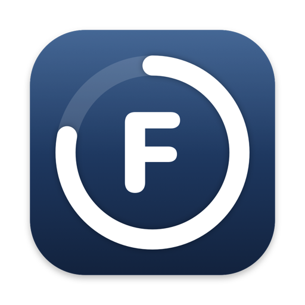

<p align="center">
  
</p>

# Friday

A calendar and to-do list that decides when things get done. You put in what you have to do, roughly how long it takes
and when it's due; Friday reads your calendars and plans the work into the time around your events. It replans when
something changes, learns how long things really take you and what you prefer, and tells you plainly when more is due
than fits.

Friday runs on your own Mac. Your calendars, to-dos and everything Friday learns stay on it: there is no account and
no Friday server.

**Download it at [friday-scheduler.com](https://friday-scheduler.com)** (free, for macOS 14 or later). The
[Help page](https://friday-scheduler.com/help.html) covers using it; this README is for reading and building the code.

## What it does

- **Plans your week.** Classes, events, meals and sleep are fixed; your to-dos are fitted around them, each before its
  due, and fitted again whenever something moves.
- **Takes to-dos the way you'd say them:** `essay 3h due fri`, `read chapter 4 1h due tomorrow`.
- **Rules in your own words:** "no work after 10pm", "readings in the morning". Friday plans by them, and says when one
  had to bend.
- **Learns** how long each kind of work really takes you, and which plans you prefer.
- **Reads what you already use:** your Mac's calendars (Google Calendar through the Mac), calendar links from school or
  work, deadlines in your mail, and to-dos from Todoist, TickTick, Notion, Trello, Apple Reminders, Things, Google Tasks,
  Asana, Linear, Jira, GitHub, Canvas and Slack.
- **No notifications.** Anything that needs you waits in the Inbox, with a count.
- **Brings no AI of its own.** Connect the one you use (the `claude` command, an API key from Claude, OpenAI or Gemini,
  or a model on your Mac) to ask in words; without one, everything else works.

## How it's built

| | |
| --- | --- |
| [`src/friday`](src/friday) | `fridayd`, the server, and `friday`, its command line, in Python: the engine (an allocator, a scheduler and the rules it plans by), the planner, learning, the integrations, and the commands (each one an HTTP endpoint, a CLI verb and an MCP tool) |
| [`web`](web) | The app itself, a website `fridayd` serves: React, Vite and TypeScript |
| [`Mac`](Mac) | The Mac app around the website, in Swift with no Xcode project: global shortcuts, menus, the Dock icon with the Inbox's count, the timer in the menu bar, and the Mac's calendars and reminders |
| [`tests`](tests) | The server's tests, from single rules to whole simulated terms |
| [`pages`](pages) → [`site`](site) | [friday-scheduler.com](https://friday-scheduler.com) (`build_pages.py` makes `site/` from `pages/`) |
| [`scripts`](scripts) | Building, checking, deploying and releasing |
| [`DESIGN.md`](DESIGN.md) | The design: the engine, the server and every page |
| [`BackendGuidelines`](BackendGuidelines) | Research behind the planning engine |

The Mac app's menus and shortcuts send the website a `friday:host` event
([`web/src/shell/host.ts`](web/src/shell/host.ts)), so the Mac app and a browser share one implementation.

## Building it yourself

You need macOS 14 or later, the Xcode Command Line Tools, [uv](https://docs.astral.sh/uv/) (it brings Python) and
Node.

```bash
uv sync                                                  # the server and its tests
npx pnpm@10.12.1 --dir web install                       # the website's packages
npx pnpm@10.12.1 --dir web build                         # the website, into web/dist
uv tool install --editable .                             # fridayd and friday in ~/.local/bin
fridayd init                                             # your time zone (detected) and sleep times
fridayd serve                                            # Friday at http://127.0.0.1:8765
```

Or build the Mac app, which starts `fridayd` itself and stops it when you quit:

```bash
Mac/build.sh             # Mac/build/Friday.app
Mac/build.sh --install   # into /Applications, and open it
```

To try Friday as a brand-new user without touching your own data:

```bash
Mac/build.sh --test           # Friday Test: the Mac app with a user of its own, on its own port
scripts/fresh_user.sh         # the website alone, as a new user, in your browser
fridayd demo --case alex --ready --port 8799   # a student three weeks into using Friday, with stand-in calendars, mail and AI
```

Settings and keys live beside each other: `friday.toml` (see [`friday.example.toml`](friday.example.toml)) and
`secrets.toml`, which Friday writes readable only by you and which never belongs in git.

## The Mac app's shortcuts

| | |
| --- | --- |
| ⌃⌥Space | Friday, from any app; again to put it away |
| ⌥Space | A new event, from any app |
| ⌃Space | Ask Claude, from any app |
| ⌘N, ⇧⌘N | A new event, a new to-do |
| ⌘F | Search |
| ⌘1, ⌘2, ⌘3 | Day, week, month |
| ⌘T | Today |
| ⌃⌘T | The to-do drawer |
| ⌥⌘1 … ⌥⌘6 | Plan, To-do, Projects, Inbox, Insights, Rules |
| ⌥⌘, | Friday's settings |
| ⌘J | Ask Claude |

The global shortcuts can be turned off in Friday → Settings.

## Tests

```bash
scripts/check.sh   # ruff, pytest, the site's tests, the website's typecheck and tests, and the Mac app's (about 25 minutes)
Mac/test.sh        # the Mac app's alone
```

The website's screen tests run the whole app against a real `fridayd` serving a simulated student's term. Tests never
call a real AI or a real service: `tests/conftest.py` switches off the AI commands and keys, and the integrations are
tested against stand-ins.

## Contributing

See [CONTRIBUTING.md](CONTRIBUTING.md): start from an issue, work on a fork, and open a pull request with tests.

## Licence and terms

Friday's code is under the [PolyForm Noncommercial License 1.0.0](LICENSE): you may read it, change it and share it
for any noncommercial purpose, but you may not sell Friday, or anything built from its code, or otherwise make money
from it, without a licence from Ruben Hayrapetyan. The code comes as is, with no warranty and no responsibility taken
for it or for anything built from it. Using the app is covered by its [terms](TERMS.md), which everyone accepts when
Friday first opens.
